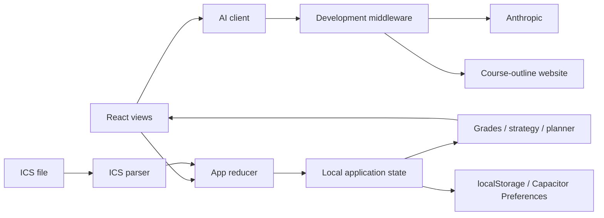

# UniBalance architecture for maintainers

UniBalance is a web-first university study planner. The current implementation runs locally and stores student state on the device. The 15 November 2026 audit found material correctness and production-readiness gaps; consult the [remediation backlog](remediation-plan.md) and actual code/tests for each fix's current status. This document maps the system rather than asserting that every advertised workflow is correct.

## Runtime and boundaries

| Concern | Implementation and source |
|---|---|
| Web entry | `index.html` loads `src/main.jsx`, which mounts React and `src/UniBalance.jsx`. Vite builds the web assets; Tailwind supplies styling. |
| App shell | `src/UniBalance.jsx` owns reducer state, chooses views, derives plans/strategy, and invokes persistence/native effects. Navigation uses state rather than URL routes. |
| User workflows | `src/views/Courses.jsx`, `Dashboard.jsx`, `Planner.jsx`, `Assistant.jsx` and `Insights.jsx`; shared controls and calendar under `src/components/`. |
| State changes | `src/state/appReducer.js` owns course/assessment actions, timetable import, study sessions and task history. UI should dispatch domain actions rather than manipulate persisted JSON. |
| Persistence | `src/state/persistence.js` handles normalization, versioned local storage, recovery and Capacitor Preferences. There is no database or cloud sync. Read this file and its tests before changing a schema. |
| Academic calculations | `src/lib/gradebook.js` calculates grade snapshots and pacing. `src/lib/strategy.js` ranks work and calculates target/drop scenarios. These currently separate calculations require consistency checks when grading rules change. |
| Scheduling | `src/lib/planner.js`, `rebalance.js`, `date.js` and `ics.js`; `src/components/CalendarView.jsx` renders the result. Deadline, recurrence, local-date and stable-occurrence semantics must be verified together. |
| AI boundary | `src/lib/aiClient.js` calls `/api/anthropic/messages`, `/api/course/import`, and `/api/course/import-file`. `server/anthropicProxy.js` and `server/courseImport.js` call Anthropic; the URL importer also fetches the supplied site. |
| Development server | `vite.config.js` attaches those handlers through `configureServer`. A static web build does not itself contain a production API. Hosting and the production server/authentication design remain undecided. |
| Native wrapper | `capacitor.config.ts`, `ios/`, `android/`, `src/lib/nativeShell.js`, and `notifications.js`. These wrap the web UI and provide preferences/notifications. Native feature/release work is paused. |
| Coding-agent tools | `scripts/agent-context.mjs` reads allowlisted tracked source to produce local, cited evidence. It is separate from the student-facing AI assistant and never sends code to Anthropic. |

## Data and workflow contracts

The central collections are courses, assessments, commitments, study sessions, task history and academic key dates. Courses are currently related by course code; assessments and sessions have generated IDs. Recurring grading uses series metadata on assessments. IDs, relationships, unknown dates/marks, numeric zero and migration provenance are domain concerns, not display defaults.

Course creation and imports feed reducer actions. Study logging updates session history and assessment progress, then derived strategy/plans recalculate. Grading edits must not equate “worked on”, “submitted”, “graded” and “passed”; any change should test those distinctions across both gradebook and strategy. Scheduling changes must exercise the planner, rendered calendar and notifications using the same dated cases.

AI extraction and explanations cross a network/privacy boundary. Course documents and contextual app data may be sent to the provider when those features are used. Model output and imported pages are untrusted; field validation and user review must be explicit. Keep credentials on the server, use mocks and synthetic data in tests, and do not confuse a local middleware route with an authenticated production service.

## How to investigate a change

| Change | Read and verify together |
|---|---|
| Saved-state behavior | `src/state/persistence.js`, `appReducer.js`, shell effects and persistence/reducer tests; repeated roundtrips, old versions and failure recovery. |
| Grades or task priority | Gradebook, strategy, reducer and Courses/Insights views; independently calculated numbers, real zero, missing marks and best-of rules. |
| Planning or time | Date/ICS/planner/rebalance/notifications and calendar/timer views; local day boundaries, recurrence, deadlines, unavailable capacity and duplicate events. |
| AI/imports | Client, both server modules, Courses/AICapture/Assistant and server tests; provider failures, invalid output, duplicate import and resource/access limits. |
| Build/deployment | `package.json`, lockfile, Vite config and current CI/release documentation. Build success alone does not establish API availability or production readiness. |

Use `node scripts/agent-context.mjs query "relevant identifiers"` for exact current line citations, then read callers and tests. The roadmap describes intended direction; the implementation and executed checks establish current behavior. Do not turn this map into an implicit mandate to introduce a new framework, cloud provider or database.
